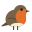
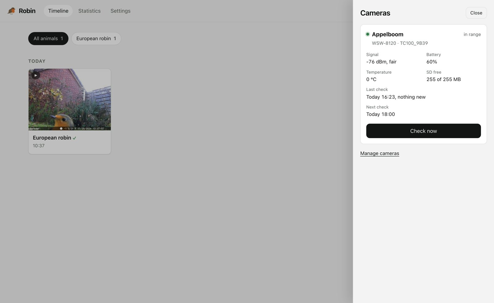

<p align="center"></p>

# Robin

**A multi wildcam app.** Robin collects the clips from cheap Wi-Fi/Bluetooth trail cameras automatically, lets a few models decide which animal walked by, and shows everything from all your cameras on one timeline.



Cheap trail cameras record to an SD card and hand their clips only to a phone app standing next to them. This project skips the app: an ESP32 wakes the camera over Bluetooth and joins its hotspot, a Raspberry Pi talks the camera's protocol through the ESP32 and downloads the clips, and Robin (a small web app on a home server) fetches them, deletes them from the camera, and runs the species models.

Built and tested with the **Denver WSW-8120** (TrailCam Go app). Other cameras that use the same app and protocol family should work, but haven't been tried.

The story behind it: [The birdbox gets eyes](https://daangeijs.nl/posts/birdbox-trail-camera/).

## How it fits together

```
trail camera ──Bluetooth + Wi-Fi── ESP32 ──USB serial── Raspberry Pi ──network── Robin
                                   (esphome/)            (bridge/)               (app/)
```

- **ESP32** (`esphome/`): an ESPHome device with a custom `camlink` component. It wakes the camera over Bluetooth, keeps that connection open, joins the camera's hotspot, and passes every UDP packet over the USB cable to the Pi and back. It stores nothing; it's a radio on a cable. It also reports camera status to Home Assistant and can act as a Bluetooth proxy.
- **Bridge** (`bridge/`): a Python service on the Pi. It speaks the camera's protocol through the ESP32 (log in, status, list, download, delete, settings), turns the camera's H.264 + AAC into MP4, and offers the clips on a small HTTP API. It is passive: a session only starts when Robin asks.
- **Robin** (`app/`): a FastAPI web app. It decides when each camera is checked, pulls the clips, deletes them from the bridge, and lets SpeciesNet, DeepFaune and (optionally) Claude vote on the species. You get a timeline, statistics, a camera panel with signal, battery, solar charging, temperature and free space, a date bar with weather and moon phase over every clip, and downloads with or without that bar burnt in. Dutch and English.

Why the detour through a Pi: an ESP32 has one Wi-Fi radio, so it can't sit on the camera's hotspot and on your home network at the same time, and a basic ESP32 has nowhere to keep a 7 MB clip while it switches. Over USB at 921,600 baud a 10-second 1080p clip takes about two minutes, which is fine because the clips wait on the camera's SD card until they've been fetched.

## What you need

- A Wi-Fi/Bluetooth trail camera of the TrailCam Go family (tested: Denver WSW-8120)
- An ESP32 dev board (ESP32-WROOM is enough) within Bluetooth and Wi-Fi range of the camera
- A Raspberry Pi (anything that runs Python 3 and ffmpeg; a Pi 2 works) with a USB port for the ESP32 and a network connection
- A home server or cluster for Robin (Docker image, or the Kubernetes manifests in `deploy/k8s/`)

## Setup

### 1. ESP32

```sh
cd esphome
cp secrets.example.yaml secrets.yaml   # fill in Wi-Fi and keys
# set camera_mac in wildcam-bridge.yaml to your camera's Bluetooth MAC (it advertises as TC100_xxxx)
esphome run wildcam-bridge.yaml        # first flash over USB, later over the air
```

UART0 (the USB port) is the link to the Pi, so the ESPHome logger is off on serial; logs go through the API.

### 2. Bridge on the Pi

See [bridge/README.md](bridge/README.md). In short: copy `bridge/` to the Pi, run `install.sh`, adjust `/etc/trailcam-bridge.env` (serial port, token), and enable the service.

### 3. Robin

```sh
docker build -t robin app/
docker run -p 8000:8000 -v robin-data:/data -v robin-models:/models robin
```

Or use `deploy/k8s/` (Kustomize; set your image, hostname and storage). Settings via environment variables, all optional:

| Variable | What it does |
| --- | --- |
| `WILDCAM_DATA_DIR` | Database, clips and thumbnails (default `/data`) |
| `WILDCAM_MODELS_DIR` | Model weights cache (default `/models`) |
| `WILDCAM_COUNTRY` | Country code for SpeciesNet's geofence (default `NLD`) |
| `WILDCAM_MIN_SCORE` | Below this a verdict counts as unsure (default `0.5`) |
| `WILDCAM_INGEST_TOKEN` | Bearer token for `POST /api/ingest`; empty disables uploads |
| `WILDCAM_HA_WEBHOOK_URL` | Home Assistant webhook for notifications |
| `WILDCAM_BASE_URL` | Public URL, for links in notifications |

Then open Robin, go to Settings, and add a camera: a name, the bridge's address (for example `http://192.168.1.50:8090`), and the hours at which it should be checked. Each check costs the camera a short Wi-Fi session, so mostly at night. A location in the settings enables weather and day/night per clip (from Open-Meteo, no account needed; only the location and the date are sent).

## The camera protocol, briefly

- The camera keeps a Bluetooth LE beacon on. Writing the wake value to its service makes it switch on a Wi-Fi hotspot and reply with the SSID and password.
- On the hotspot it speaks a CS2/PPPP-style UDP protocol with AES-encrypted JSON commands: 512 status, 513 settings, 768 list, 769/770 video download, 773 delete.
- The hotspot switches off as soon as Bluetooth disconnects, so the ESP32 holds the connection during a session.

The details are in the code: `bridge/trailcam_bridge/camera.py` (with markers for where each fact came from) and `esphome/components/camlink/`.

## Thanks

- [Geek IT Guide: Wifi BLE Trailcam Investigation](https://geekitguide.com/wifi-ble-trailcam-investigation-part-1/), which found the Bluetooth wake-up
- [TrailCamHub](https://github.com/HeikoGr/TrailCamHub) and [trailcam-automation](https://github.com/pwnb0t/trailcam-automation), for their notes and code on the same camera family
- [REA (Reverse Engineer Anything)](https://github.com/morluto/rea), used on the TrailCam Go Android app
- [SpeciesNet](https://github.com/google/cameratrapai) by Google and [DeepFaune](https://www.deepfaune.cnrs.fr/) by CNRS for the species models

## Disclaimer

An independent hobby project, not affiliated with or endorsed by Denver or the makers of TrailCam Go. It talks to a camera you own, on your own network. Use at your own risk.

## License

MIT, see [LICENSE](LICENSE).
